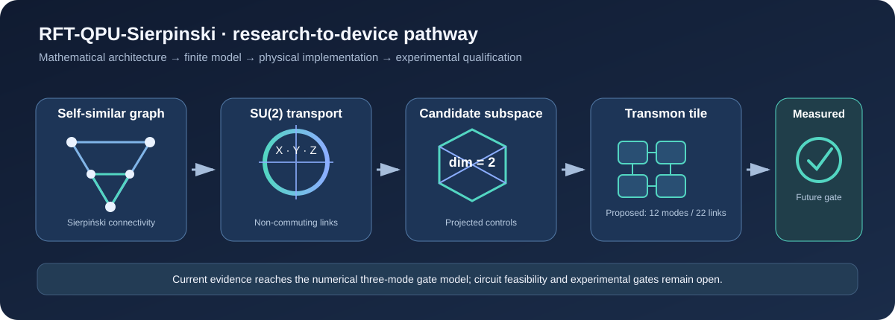
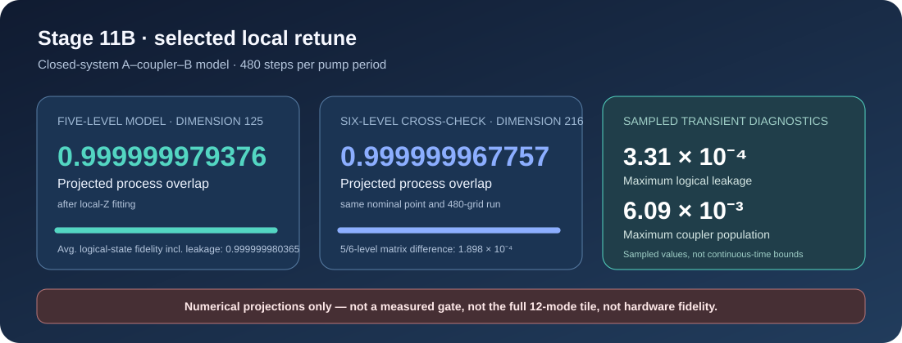
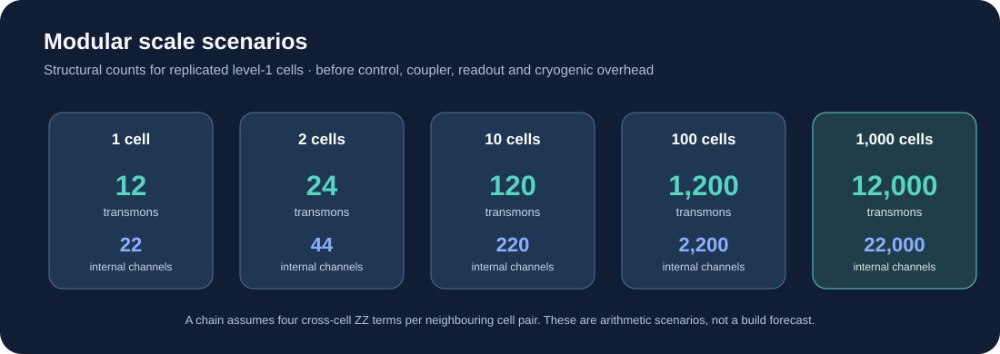
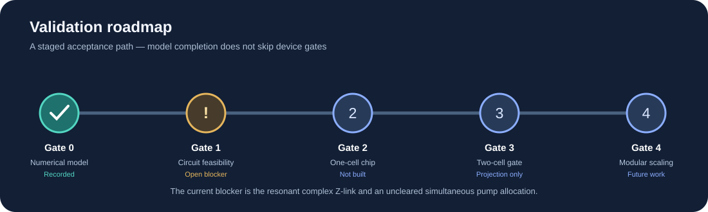

# RFT-QPU-Sierpinski

> **A research architecture for a self-similar quantum-processing element with non-Abelian SU(2) transport.**

**Project author attribution:** Evgeny Zaprudnov  
**Programme:** RFT-SIRM · **Engineering checkpoint:** v0.4-rc1 · **Review date:** 12 November 2026

This repository is prepared as a **public research and engineering record** for technical inspection, reproducibility, independent review and collaboration. It documents a numerical architecture and a proposed superconducting-transmon implementation. It does not claim that a quantum processor has been fabricated, measured, or made fault tolerant.

---

## Executive view

RFT-QPU-Sierpinski studies whether a self-similar graph can serve as the connectivity substrate for a logical quantum degree of freedom carried by non-commuting SU(2) edge transports.

The first hardware mapping is a level-1 Sierpiński-gasket tile:

- **6 graph sites** and **9 graph edges**;
- **3 selected non-commuting SU(2) links** (X, Y and Z);
- **12 transmon modes** representing the graph-site spinor components;
- **22 non-zero effective exchange channels**;
- a candidate logical state encoded in a two-dimensional low-energy subspace.

The software programme records Stages 1–11B. The latest Stage 11B work contains a nominal full three-mode re-quantized gate baseline, local pulse retuning, five-/six-level comparisons and a seven-level spot check. The best retuned numbers are model outputs, not measured hardware fidelities.

*The level-1 topology is a proposed device mapping. The schematic and coefficient tables are design artifacts, not a fabrication netlist.*

## Architecture

For a finite graph G = (V,E), each site carries a two-component internal degree of freedom. A representative graph Hamiltonian is

H = D ⊗ I₂ − Σ(a,b) [ |a⟩⟨b| ⊗ Uₐᵦ + h.c. ],

with SU(2) transport Uₐᵦ = exp(−i θ σₐₓᵢₛ / 2) and nominal connection angle θ = π/2. The candidate logical qubit is a selected two-dimensional low-energy subspace. Physical controls are projected into that subspace and must be calibrated and tested independently.

The hardware mapping uses pairs of transmon modes at graph sites. Parametric exchange is proposed for complex hopping phases. In the current degree-based frequency plan, the active Z edge is resonant and requires complex diagonal amplitudes. A single real static coupler cannot implement those phases. A phase-engineered multi-path or auxiliary Floquet implementation, or a revised frequency/rotating-frame plan, is therefore a **pre-tape-out blocker**.

Detailed hardware definitions: [Architecture](docs/ARCHITECTURE.md) · [Physical realization](engineering/physical_prototype/docs/PHYSICAL_REALIZATION.md) · [Industrial architecture](engineering/physical_prototype/docs/INDUSTRIAL_ARCHITECTURE.md).

## Latest numerical checkpoint

### Stage 11B — re-quantized three-mode gate model

The selected local operating point recorded in this repository is:

| Parameter | Selected point |
|---|---:|
| DC flux bias | 0.25884589447013934 Φ₀ |
| Pump frequency | 987.6171621707836 MHz |
| Flux amplitude | 0.0199946062 Φ₀ |
| Requested pulse duration | 1.081140796 μs |
| Raised-cosine ramp | 8 pump periods |

At 480 steps per period, five retained levels per mode (125-dimensional A–coupler–B product space), the reported local retune gives:

| Metric | Model result |
|---|---:|
| Projected process overlap after local-Z fit | 0.9999999793763371 |
| Average logical-state fidelity including leakage | 0.9999999803654352 |
| A → B transfer probability | 0.9999999973549074 |
| B → A transfer probability | 0.999999992602828 |
| Conditional iSWAP phase | 0.00027739757232 rad |
| Maximum sampled logical leakage | 3.312 × 10⁻⁴ |
| Maximum sampled coupler-excited population | 6.090 × 10⁻³ |

These numbers are **closed-system numerical projections** with nominal circuit assumptions. The selected retune is recorded in [the Stage 11B local-retune note](engineering/physical_prototype/docs/STAGE11B_LOCAL_RETUNE_NOTE.md). The raw JSON/NPZ files for those local retune runs are not tracked in this repository; their reported SHA-256 fingerprints are retained in the note. The original Stage 11B baseline JSON and matrix archive are tracked under engineering/physical_prototype/results/.

**Important model boundary:** Stage 11B is an A–coupler–B three-mode circuit simulation. It is not a driven simulation of the complete 12-transmon Sierpiński tile.

The six-level 480-grid process overlap was 0.999999967757. The seven-level model is only spot-checked at 120 steps per period; seven-level 240/480 propagation remains open. The five-level driven charge-cutoff screen is documented, but it does not close the full retained-level convergence question.

## Scale and engineering path

The graph counts and transmon counts below are structural outputs of the current mapping. They are not fabrication-cost, yield, wiring, packaging or cryogenic-resource estimates.

| Graph level | Sites | Edges | Transmons | Leakage gap / J | Best local g_eff |
|---:|---:|---:|---:|---:|---:|
| 1 | 6 | 9 | 12 | 1.393713 | 0.177043 |
| 2 | 15 | 27 | 30 | 0.397335 | 0.079709 |
| 3 | 42 | 81 | 84 | 0.088608 | 0.034749 |
| 4 | 123 | 243 | 246 | 0.015864 | 0.017990 |
| 5 | 366 | 729 | 732 | 0.002986 | 0.015085 |

A separate static two-cell projection gives an interaction coefficient of 0.00783608327 χ. The corresponding 6.38074 μs entangling-time estimate assumes χ/(2π) = 10 MHz and is **not a calibrated or measured gate**.

## Noise, leakage and what has not been demonstrated

The current engineering record is explicit about its limits:

- At the illustrative J/(2π) = 10 MHz, the level-1 leakage gap is 13.94 MHz. At 10 mK, kBT/h is 208.37 MHz and the corresponding equilibrium Boltzmann benchmark is about 0.935. This does not support a claim of passive thermal protection.
- The graph-wide first-order nine-tone screen reports 73 primary resonance warnings within 10 MHz and 653 conditional harmonic/intermodulation warnings. Simultaneous nine-tone operation is **not cleared**.
- The Stage 11B gate calculation does not include T1/T2, thermal-bath dynamics, flux-line transfer, pump phase noise, delay, distortion, crosstalk or layout-extracted parasitics.
- Circuit capacitances and Josephson parameters are assumptions rather than layout-extracted values.
- No chip has been fabricated or measured. There are no experimental gate fidelities, coherence times, readout results or fault-tolerance demonstrations.

See [Evidence boundary](docs/DISCLOSURE_BOUNDARY.md), [Risk register](engineering/physical_prototype/docs/RISK_REGISTER.md) and [Validation gates](engineering/physical_prototype/docs/VALIDATION_GATES.md).

## Development gates

1. **Numerical model:** graph construction, SU(2) Hamiltonian, projected controls, circuit studies and regression tests are recorded.
2. **Circuit feasibility:** resolve the complex Z link, pump collisions, multilevel dynamics, open-system effects and device-specific tolerances.
3. **One-cell demonstrator:** fabricate and characterize a 12-transmon tile; measure its spectrum, controls, leakage, coherence and readout.
4. **Two-cell entangler:** build and measure a 24-transmon two-cell system and demonstrate an entangling logical gate.
5. **Modular scale-up:** scale only after measured single-cell and two-cell gates pass predeclared criteria.

A green software workflow is a model-integrity result, not a hardware-validation gate.

## IP, attribution, licensing and patent grant

**Project author attribution: Evgeny Zaprudnov.** Authorship attribution is distinct from patent inventorship and does not, by itself, prove the chain of legal title for every contribution or third-party component.

The source materials are offered under **Business Source License 1.1 (BUSL-1.1)**. During its initial term, BUSL-1.1 permits copying, modification, derivative works, redistribution and non-production use under its terms. It is a **source-available** licence, not an OSI-approved open-source licence during that initial term. No Additional Use Grant is made: production deployment, manufacture or other production use requires a separate written commercial agreement. The Change Date is 12 November 2030, or the fourth anniversary of first public distribution of this version if earlier; the Change License is GNU GPL version 2.0 only. See [LICENSE](LICENSE).

A separate [patent grant](PATENTS.md) accompanies the source licence. It grants a non-exclusive, worldwide, royalty-free patent licence only to the extent the licensor actually owns or controls patent claims that are necessarily infringed by the licensed contributions, and only within the use scope permitted by the applicable source licence. It does **not** create a patent, represent that a patent has been filed or extend permission to production use beyond BUSL-1.1.

No patent application number, filing date, patent office or granted patent for this project is recorded in this repository. This is a repository audit observation, not proof about documents held outside it. Public disclosure is intentional and may affect later patent filings depending on jurisdiction, timing and the enabling content disclosed. See [PATENTS.md](PATENTS.md) and [technical disclosure](PATENT_SPEC.md).

The full technical record is being made available to invite external scrutiny and collaboration. Important engineering gates remain open: the complex Z-link implementation, graph-wide pump schedule, open-system validation, and physical demonstration. These limitations are recorded rather than hidden.

## Collaboration and contact

Researchers, superconducting-circuit engineers, quantum-control specialists and potential strategic partners are invited to review the work. For technical questions, reproducibility reports, suggested corrections or collaboration proposals, open a GitHub Issue or use the contact route on the [RFT-SIRM GitHub profile](https://github.com/RFT-SIRM). Use pull requests for documented corrections. Do not post credentials, private third-party information or confidential material in public issues.

## Reproducibility

From the repository root:

    python -m pip install -e 'engineering/physical_prototype[test]'
    python -m pytest -q tests engineering/physical_prototype/tests

The Stage 11B baseline runner is:

    python engineering/physical_prototype/scripts/run_stage11b_requantized_gate.py

Historical local pre-release preparation recorded 75 passing tests on Python 3.14.2. The public-release baseline commit db606c428183aab0b637ce449d08b604d260e0e4 then passed [GitHub Actions run #29](https://github.com/RFT-SIRM/RFT-QPU-Sierpinski/actions/runs/43134406595): 78 tests passed, and the level-1 device calculation, two-cell projected-interaction calculation, and graph-wide qutrit/Floquet collision audit all completed successfully on Python 3.11. These checks validate the encoded software/model workflow, not physical hardware.

## Repository map

| Document | Purpose |
|---|---|
| [COMPARISON.md](COMPARISON.md) | Architecture and noise-evidence comparison |
| [INVESTOR_BRIEF.md](INVESTOR_BRIEF.md) | Research and strategic-partner brief |
| [PATENT_SPEC.md](PATENT_SPEC.md) | Public technical disclosure and patent-counsel reference |
| [IP_AND_LICENSING.md](IP_AND_LICENSING.md) | Authorship, licensing, patent grant and commercial terms |
| [PATENTS.md](PATENTS.md) | Supplemental patent grant and disclosure notice |
| [REPOSITORY_STATUS.md](REPOSITORY_STATUS.md) | Audited project status |
| [docs/VALIDATION_PLAN.md](docs/VALIDATION_PLAN.md) | Staged evidence and hardware acceptance plan |
| [engineering/physical_prototype/README.md](engineering/physical_prototype/README.md) | Numerical package and stage map |
| [engineering/physical_prototype/results/RESULT_SUMMARY.md](engineering/physical_prototype/results/RESULT_SUMMARY.md) | Finite-level and two-cell result summary |

**Status:** v0.4-rc1 public research baseline prepared for repository publication. Numerical-model checkpoint only; not a fabrication release, tape-out package or experimentally validated QPU.
