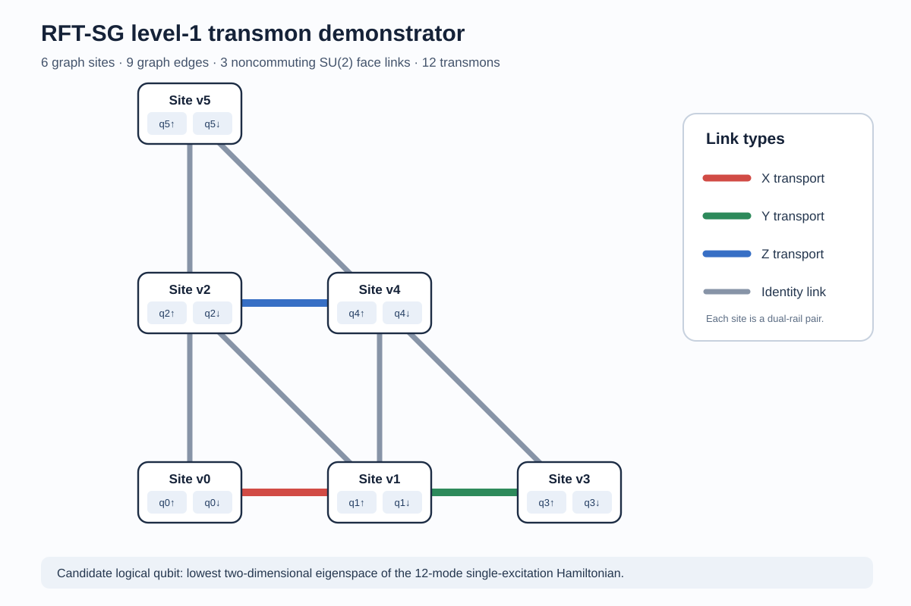

# RFT-QPU-Sierpinski

> **A research architecture for a gauge-covariant fractal SU(2) quantum-processing element.**

[](https://github.com/RFT-SIRM/RFT-QPU-Sierpinski/actions/workflows/test.yml)
[](engineering/physical_prototype/README.md)
[](#level-1-transmon-tile)
[](#level-1-transmon-tile)
[](#research-status)
[](LICENSE.md)

---

## Navigation

**[Executive Summary](#executive-summary)** · **[Architecture](#architecture)** · **[Level-1 Transmon Tile](#level-1-transmon-tile)** · **[Mathematical Anchor](#mathematical-anchor)** · **[Qubit Passport](#qubit-passport)** · **[Validation](#validation)** · **[IP / Patent](#ip--patent-position)** · **[Repository Map](#repository-map)** · **[Installation](#installation)**

---

## Executive Summary

RFT-QPU-Sierpinski investigates a quantum-processing architecture in which a self-similar Sierpiński-gasket graph carries non-Abelian SU(2) edge transport. The first hardware embodiment now has a reproducible **level-1 numerical prototype** mapped to a proposed superconducting-transmon tile.

The current tile has **6 graph sites, 9 graph edges, 3 non-commuting SU(2) links, 12 transmon modes in the single-excitation model, and 22 effective exchange channels**. Its candidate logical qubit is the lowest two-dimensional spectral subspace of the finite Hamiltonian.

The project keeps three evidence layers separate:

1. **Mathematical anchor.** The companion [Evgeny's Theorem](https://github.com/RFT-SIRM/Evgeny-Theorem) repository documents the fourth spectral-moment identity and its normalized limit.
2. **Numerical prototype.** This repository contains a finite-level solver, projected-control analysis, hardware coefficient exports, two-cell projection, and regression tests.
3. **Physical hardware.** The transmon mapping is a design proposal. No device has been fabricated or measured; complex-Z coupling, multilevel circuit-QED, calibration, noise, leakage, and gate fidelity remain open engineering work.

The intended sequence is mathematical reproducibility → numerical characterization → physical single-cell demonstrator → two-cell entangler → modular scaling.

---

## Architecture

For a graph with vertices `V`, degree operator `D`, and SU(2) edge transports `U_ab`, the research Hamiltonian is represented schematically as

$$
H = D \otimes I_2 - \sum_{(a,b)} |a\rangle\langle b| \otimes U_{ab} + \mathrm{h.c.}
$$

with selected transports

$$
U_{ab}=\exp\left(-i\frac{\theta}{2}\sigma_\alpha\right),
\qquad \alpha\in\{x,y,z\}.
$$

The nominal research point is

$$
\theta = \frac{\pi}{2}.
$$

A candidate logical qubit is a selected two-dimensional low-energy subspace with projector `P`, subject to numerical verification of spectral isolation and control quality. Candidate projected controls are

$$
X_L=P S_xP,\qquad Y_L=P S_yP,\qquad Z_L=P S_zP.
$$

These definitions specify the effective graph model. The transmon realization and any protection or fault-tolerance claim require separate physical validation.

---

## Level-1 Transmon Tile

The first proposed hardware embodiment maps each graph site to a dual-rail pair of transmons. The single-excitation sector contains 12 modeled modes and reproduces the level-1 SU(2) graph Hamiltonian.

<p align="center">
  
</p>

<p align="center"><sub>Proposed topology: 6 graph sites · 9 graph edges · 3 non-commuting SU(2) face links · 12 transmons. This is a design schematic, not a fabricated chip.</sub></p>

| Link class | Graph edges | Effective exchange channels |
|---|---:|---:|
| Identity | 6 | 12 |
| X transport | 1 | 4 |
| Y transport | 1 | 4 |
| Z transport | 1 | 2 |
| **Total** | **9** | **22** |

The active Z link is the present implementation blocker: its required hopping amplitudes are complex, while a single real static coupler cannot reproduce them. A phase-engineered parametric or multi-path implementation, or a revised rotating-frame/frequency plan, must be worked out before tape-out. See [Physical Realization](engineering/physical_prototype/docs/PHYSICAL_REALIZATION.md) and the [hardware risk register](engineering/physical_prototype/docs/RISK_REGISTER.md).

---

## Mathematical Anchor

The companion repository establishes the central fourth-moment result numerically and analytically at the stated mathematical level:

$$
\Delta_m(H^4,\theta)
=-16\left(3^{m-1}+1\right)\sin^2\left(\frac{\theta}{2}\right).
$$

With normalization by `3^(m+1)+3`, the intensive invariant at `θ = π/2` approaches

$$
I_m\left(\frac{\pi}{2}\right)\longrightarrow -\frac{8}{9}.
$$

The current companion repository also documents gauge-invariance checks, vanishing of the first three spectral moments in the relevant defect construction, higher-moment numerical results, and the current Lean 4 formalization boundary. See the [theorem repository](https://github.com/RFT-SIRM/Evgeny-Theorem).

> **Important:** `−8/9` is a normalized fourth spectral-moment invariant. It is **not** an energy gap and must not be presented as one.

---

## Qubit Passport

| Parameter | Research specification |
|---|---|
| Geometry | Sierpiński-gasket graph |
| Internal degree | SU(2) spinor / pseudospin |
| Nominal connection angle | `θ = π/2` |
| Logical dimension | `dim(Q) = 2` candidate subspace |
| Encoding | Selected low-energy subspace `Q = Ran(P)` |
| Logical controls | `P Sx P`, `P Sy P`, `P Sz P` |
| Spectral anchor | `I∞(π/2) = −8/9` |
| Effective-control scale | Level 1: `g_eff = 0.1770433` at vertex 5; level 5 reference: `g_eff ≈ 0.015085`; level-dependent |
| Leakage gap | Must be recomputed for graph refinement, normalization and physical parameter set |
| Experimental status | Not experimentally validated |

### Evidence boundary

The value is **level- and convention-dependent**. The current finite-level study reports `g_eff = 0.1770433` for the level-1 local control at vertex 5, while `g_eff ≈ 0.015085` is the level-5 reference value. They are different finite graphs, not competing estimates of one universal constant.

The computed level-1 leakage gap is `1.3937126931 J`. Neither this gap nor any other device gap follows from `I∞ = −8/9`; the latter is a normalized fourth-moment invariant.

---

## Validation

The numerical prototype now computes the finite-level graph, candidate doublet, leakage separation, projected local controls, hardware channel map and two-cell projected interaction. Physical acceptance still requires:

- two-dimensional logical-subspace isolation;
- reproducible spectral gap to leakage states;
- projected-control linear independence and controllability;
- gate fidelity under calibration uncertainty;
- leakage during single- and two-qubit operations;
- sensitivity to non-gauge perturbations;
- fabrication disorder and parameter spread;
- thermal excitation and relaxation;
- readout fidelity;
- inter-qubit coupling and crosstalk;
- scaling with refinement level and device count.

Gauge covariance of the mathematical spectrum is not equivalent to immunity from arbitrary laboratory noise.

---

## IP / Patent Position

The repository contains a technical disclosure intended to organize the architecture for patent counsel review. It identifies potentially protectable combinations such as:

- self-similar graph connectivity used as a quantum-processing substrate;
- non-Abelian SU(2) edge transport;
- a prescribed connection-angle/axis construction;
- logical encoding into a selected two-dimensional low-energy subspace;
- projected logical controls;
- calibration and validation procedures tied to the spectral construction.

See **[PATENT_SPEC.md](PATENT_SPEC.md)**.

This document is a technical disclosure, **not a legal opinion and not a statement that any claim is patentable**. Patentability depends on jurisdiction, priority date, enablement, written description, novelty, inventive step/non-obviousness, and prior art.

---

## Comparison Framework

See **[COMPARISON.md](COMPARISON.md)** for a factual architecture comparison covering classical accelerators, mainstream superconducting quantum processors, and the proposed RFT-QPU architecture. It intentionally avoids unsupported claims of superiority.

---

## Installation

### Requirements

- Python 3.10+
- NumPy
- pytest for the test suite

### Quick start

```bash
git clone https://github.com/RFT-SIRM/RFT-QPU-Sierpinski.git
cd RFT-QPU-Sierpinski
python3 -m venv .venv
source .venv/bin/activate
python -m pip install -r requirements.txt
python qpu_core.py
pytest -q
```

The top-level `qpu_core.py` is a compact research reference. The full finite-level numerical and hardware-mapping package is `engineering/physical_prototype/`; install it separately using its project instructions.

---

## Closed engineering pre-release candidate v0.4-rc1 — 2026-11-11

**Release channel: closed/internal engineering pre-release candidate.** This checkpoint consolidates the Stage 1–11A numerical work so it can be reproduced and extended from a single repository state. It is a software/model pre-release, **not** a fabrication release, foundry package, tape-out authorization, or experimental hardware claim.

The standalone model and engineering package is maintained in [engineering/physical_prototype](engineering/physical_prototype/README.md). The stages are deliberately separated by evidence level:

| Stage | Work recorded | Evidence boundary |
|---|---|---|
| 1–3 | Effective three-mode stress model, parameter sweeps, and Stage-3 charge-basis circuit assumptions | Declared circuit assumptions; not layout-extracted parameters |
| 4–6 | Four-state logical gate propagation, local-Z frame fitting, full-matrix temporal convergence, and common-duration checks | Closed-system calculation in the retained Stage-5 local coupler basis |
| 7–8 | Harmonic, chirp, and envelope exploration | Exploratory candidates; no waveform promoted solely from coarse-grid gains |
| 9–10 | Shifted-bias and local frequency/duration refinement | Converged 120/240/480 candidate in the Stage-5 fixed local coupler basis |
| 11A | Explicit local SQUID-coupler re-quantization at shifted DC flux, with charge-cutoff and retained-subspace comparisons | Local coupler audit only; full three-mode driven gate has not yet been rebuilt in this new basis |

### Best currently converged full-gate candidate — Stage 10

| Quantity | Result |
|---|---:|
| DC flux | `0.259343676252 Φ₀` |
| Pump frequency | `987.609221499 MHz` |
| Pump offset from shifted static detuning | `-64.000 kHz` |
| Flux amplitude | `0.020000 Φ₀` |
| Common physical pulse duration | `1.081002799582 μs` |
| Raised-cosine ramp | `8.0` pump periods |
| A → B probability, 480 grid | `0.999983152623` |
| B → A probability, 480 grid | `0.999983152074` |
| Projected process overlap after fitted local Z, 480 grid | `0.999991271648` |
| Conditional iSWAP phase, 480 grid | `0.0021957288 rad` |
| Richardson conditional phase | `0.0021963301 rad` |

These are projected, closed-system numerical metrics. The process-overlap figure is not an experimental gate fidelity and does not include T1/T2, thermal population, flux-line distortion, crosstalk, calibration uncertainty, or fabrication spread.

### Stage 11A — local coupler re-quantization audit

At charge cutoff 12 with five retained local levels, the coupler f01 changes from 5007.500000 MHz to 5075.910813 MHz (Δ +68.410813 MHz); the minimum matched-state overlap probability is 0.9989682 and the minimum retained-subspace singular value is 0.9995692.

The Stage 11A report also includes the 8/10/12 charge-cutoff × 3/4/5 retained-level study, aligned operator matrices, overlap matrices, CSV and JSON outputs. This does **not** establish full-gate convergence with the re-quantized coupler. Stage 11B (rebuild the complete three-mode Hamiltonian and rerun the driven four-state gate in the new basis) remains open.

### Reproducibility snapshot

- Local interpreter: `Python 3.14.2`.
- Complete repository + prototype test command: `python -m pytest -q tests engineering/physical_prototype/tests`.
- Captured local result during this pre-release preparation: **75 passed in 1.33s**.
- Pre-release base commit: `d9b374c1dbd7e24050a33b13acf21f57858ff775`.
- Stage reports, scripts, tests, JSON/CSV data and complex-matrix NPZ archives are retained under `engineering/physical_prototype/`.

GitHub Actions on the release-candidate pull request is the required CI check. A local pass is not a substitute for the Python 3.11 CI run.

### Release blockers — explicitly not closed

1. Rebuild and converge the full driven three-mode gate with the Stage 11A re-quantized coupler basis (Stage 11B).
2. Complete robust sweeps using the rebuilt model; derive parameter tolerances from worst-case behavior, not a single optimum.
3. Add measured or target flux-line transfer functions, bandwidth, delay, distortion, pump phase noise and channel crosstalk.
4. Add open-system dynamics (T1/T2, thermal occupation, relaxation/dephasing, leakage and spectator channels).
5. Replace assumed capacitances/Josephson parameters with layout extraction and independent circuit-QED review.
6. Resolve the graph-wide simultaneous nine-tone Floquet collision warnings before simultaneous operation or tape-out.
7. Obtain fabrication, EM, packaging, readout, calibration and independent hardware review.

The graph-wide first-order screen remains uncleared: the existing audit reports 73 primary pump/sideband warnings within 10 MHz and 653 conditional harmonic/intermodulation warnings. These are possible resonance scenarios, not measured error rates.

**Status:** closed/internal engineering pre-release candidate v0.4-rc1 for continued numerical and circuit-design work. It is not a fabricated or experimentally validated device, not a foundry-ready design, and not permission to proceed directly to tape-out.

---

## Companion theorem repository

The mathematical reference implementation and Lean 4 formalization are maintained separately:

**[RFT-SIRM / Evgeny-Theorem](https://github.com/RFT-SIRM/Evgeny-Theorem)**

The current public status distinguishes the machine-checked graph infrastructure from the still-open general operator-level Lean proof of `TraceDefectIdentity`. That distinction is intentional and should remain visible in investor and patent materials.

---

## Repository Map

| File | Purpose |
|---|---|
| [PATENT_SPEC.md](PATENT_SPEC.md) | Patent-oriented technical disclosure |
| [COMPARISON.md](COMPARISON.md) | Factual technology comparison |
| [INVESTOR_BRIEF.md](INVESTOR_BRIEF.md) | Investor / partner one-page narrative |
| [ARCHITECTURE.md](docs/ARCHITECTURE.md) | Mathematical-to-transmon architecture and current device mapping |
| [site preview](docs/index.html) | Responsive, self-contained architecture presentation |
| [SITE_DEPLOYMENT.md](docs/SITE_DEPLOYMENT.md) | Publication boundary and deployment prerequisites |
| [VALIDATION_PLAN.md](docs/VALIDATION_PLAN.md) | Updated numerical-to-hardware validation gates |
| [level-1 topology SVG](engineering/physical_prototype/design/level1_transmon_topology.svg) | Source schematic for the 12-transmon demonstrator |
| [DISCLOSURE_BOUNDARY.md](docs/DISCLOSURE_BOUNDARY.md) | What is established vs proposed |
| [qpu_core.py](qpu_core.py) | Minimal numerical core |
| [engineering/physical_prototype/README.md](engineering/physical_prototype/README.md) | Executable numerical and engineering prototype |
| [tests/test_qpu_core.py](tests/test_qpu_core.py) | Core simulator tests |
| [requirements.txt](requirements.txt) | Runtime/test dependencies |
| [CITATION.cff](CITATION.cff) | Citation metadata |
| [LICENSE.md](LICENSE.md) | Business 1.0 proprietary license |

---

## Research Status

**Status: closed/internal engineering pre-release candidate v0.4-rc1 (software/model checkpoint); physical hardware remains pre-experimental.**

No statement in this repository should be read as a claim of demonstrated fault tolerance, universal error correction, arbitrary-noise immunity, commercial fabrication readiness, or experimentally measured qubit performance.

The purpose of this repository is to make the proposed architecture precise enough to be independently simulated, challenged, refined, and eventually tested.


## Nine-tone pump collision screen — 11 November 2026

The isolated 245 MHz phase-conjugate Z link has a reduced four-qutrit process overlap of 0.999609. However, the first-order graph-wide screen of the nine-tone schedule finds a 0 MHz minimum primary resonance margin and 73 primary pump/sideband warnings within 10 MHz across the 22 channel rows. Conditional second/third harmonics and pairwise intermodulation scenarios raise the warning count to 653. These are possible resonances if cross-coupling exists, not measured error probabilities.

The current schedule is **not cleared for simultaneous nine-tone operation**. Reproduce the audit from the engineering package with `PYTHONPATH=src python scripts/run_floquet_audit.py`. See [the detailed audit](engineering/physical_prototype/docs/FLOQUET_COLLISION_AUDIT.md). A redesigned frame assignment, measured 22×22 channel-transfer matrix and explicit data–coupler–data circuit model remain required.
