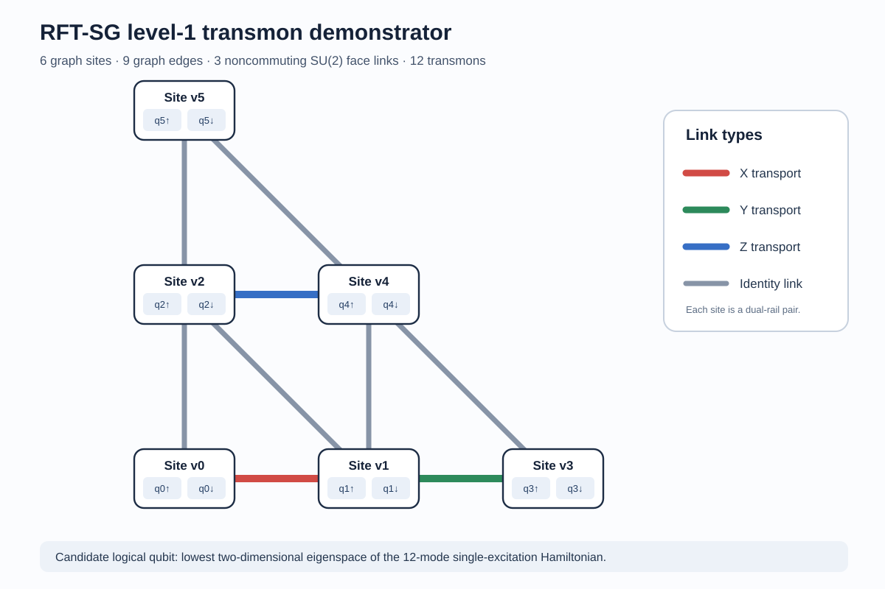
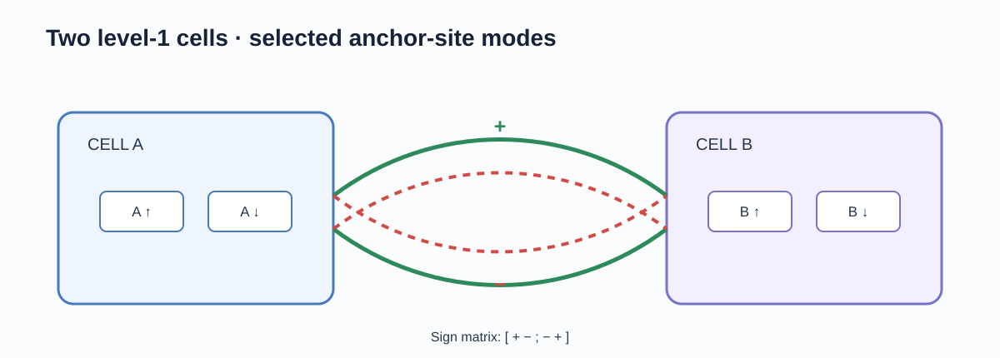

# RFT-QPU-Sierpinski Architecture

## Status and scope

This document connects the mathematical SU(2) graph model to the first proposed superconducting-transmon embodiment. The finite-level numerical prototype is implemented in `engineering/physical_prototype/`. The hardware mapping is a design study, not a fabricated or measured device.

The first build target is **one SG level-1 cell**, not a large refinement:

- 6 graph sites;
- 9 graph edges;
- 3 selected non-commuting SU(2) face links;
- 2 transmons per graph site (12 data transmons);
- a 12-dimensional single-excitation model;
- 22 nonzero effective exchange channels.

## 1. Mathematical substrate

For a finite graph \(G=(V,E)\), each site carries a two-component internal degree of freedom. The Hilbert space used by the graph model is

\[
\mathcal H = \mathbb C^{|V|}\otimes\mathbb C^2.
\]

The effective magnetic graph operator is

\[
H = D\otimes I_2 -
\sum_{(a,b)\in E}
\left(
|a\rangle\langle b|\otimes U_{ab}
+
|b\rangle\langle a|\otimes U_{ab}^{\dagger}
\right),
\]

where \(D\) is the graph-degree operator and the selected edge transports are

\[
U_{ab}=\exp(-i\theta\sigma_\alpha/2),
\qquad
\alpha\in\{x,y,z\},
\qquad
\theta=\pi/2.
\]

The recursive graph, edge orientation, face ordering and axis assignment follow the companion reference implementation. They are not interchangeable with an arbitrary triangular graph carrying hand-assigned colours.

## 2. Level-1 graph to transmon modes

Each graph site \(v\) is mapped to a pair of weakly anharmonic modes:

- \(q_{v,\uparrow}\) represents \(|v,\uparrow\rangle\);
- \(q_{v,\downarrow}\) represents \(|v,\downarrow\rangle\).

The numerical graph model is restricted to the single-excitation sector

\[
\sum_v (n_{v,\uparrow}+n_{v,\downarrow})=1.
\]

The two transmons at one site form a **synthetic SU(2) degree of freedom**. They are not being described as two independent logical qubits. In the first tile, six sites therefore require twelve data transmons.

The nine graph edges are six identity links plus one selected face link of each non-commuting axis:

| Link class | Graph edges | Channels per edge | Total channels | Effective term |
|---|---:|---:|---:|---|
| Identity | 6 | 2 | 12 | Spin-preserving exchange |
| X | 1 | 4 | 4 | Complex spin-mixing exchange |
| Y | 1 | 4 | 4 | Complex spin-mixing exchange |
| Z | 1 | 2 | 2 | Spin-preserving exchange with opposite complex phases |
| **Total** | **9** | — | **22** | — |

The channel counts are the nonzero entries of the coefficient-to-channel map. They are not a count of physical coupler packages or control electronics.

## 3. Hamiltonian-to-circuit mapping

For \(\theta=\pi/2\), the X and Y links require off-diagonal spin-mixing channels with controlled complex phases. The Z link has diagonal amplitudes with opposite phases. The proposed circuit primitive is a tunable-coupler transmon array using phase-coherent parametric exchange, where the pump phase sets the phase of the effective hopping.

The coefficient export in `hardware/level1/couplers.csv` records the intended complex channel amplitudes and the degree-based endpoint-frequency plan.

### Immediate blocker: the resonant complex-Z link

In the current level-1 frequency plan, the active Z edge connects two degree-4 sites and is resonant. Its diagonal hopping amplitudes are non-real. A single real static coupler cannot implement those phases.

Before tape-out, this needs a concrete circuit-level solution, such as:

1. a multi-path static-flux coupler with a controllable complex phase;
2. an auxiliary Floquet/parametric path with phase-locked pumping; or
3. a revised rotating-frame/frequency plan that preserves the target effective Hamiltonian.

The selected solution must be checked for residual ZZ, spectator interactions, pump sidebands, phase drift, leakage to higher transmon levels and calibration cross-talk. The current CSV is a coefficient map, **not a foundry-ready netlist**.

## 4. Candidate logical subspace and controls

Diagonalization of the level-1, 12-mode single-excitation Hamiltonian gives a candidate lowest two-dimensional subspace. The current numerical report gives:

| Quantity | Level-1 result | Interpretation |
|---|---:|---|
| Mode count | 12 | Six dual-rail sites |
| Lowest-doublet splitting / \(J\) | \(1.61\times10^{-15}\) | Floating-point roundoff scale; not a proof of exact degeneracy |
| Gap to next eigenvalue / \(J\) | 1.3937126931 | Finite-model leakage separation |
| Best local projected-control coefficient | 0.1770433 | Vertex 5, local-control convention |

The logical operators are obtained by projection into the candidate subspace:

\[
X_L=P S_x P,\qquad Y_L=P S_y P,\qquad Z_L=P S_z P.
\]

At level 1, vertex 5 is the best local control site in the current search. The reported \(g_{\mathrm{eff}}=0.1770433\) belongs to this finite graph and this operator convention. The level-5 reference value \(g_{\mathrm{eff}}\approx0.015085\) is a different refinement, not the same device parameter.

The near-zero computed splitting is consistent with the model's effective antiunitary symmetry, but this floating-point calculation alone is not a formal proof of exact degeneracy. Nor does gauge covariance imply immunity to non-gauge laboratory noise.

## 5. From one tile to a two-cell entangler

A second demonstrator contains two independently calibrated level-1 cells: 24 modeled modes in the product of their one-excitation manifolds. The proposed inter-cell interaction couples the two modes at one selected anchor site in cell A to the two modes at the anchor site in cell B.

The differential-density interaction requires four pairwise cross-Kerr coefficients with sign pattern

\[
\begin{pmatrix}
+ & -\\
- & +
\end{pmatrix}.
\]

The current tensor-product projection gives:

- projected interaction coefficient: \(0.00783608327\,\chi\);
- illustrative ideal projected entangling time: \(6.38074\,\mu\mathrm{s}\) when \(\chi/(2\pi)=10\,\mathrm{MHz}\).

This is a static projected-Hamiltonian estimate. It omits gate envelopes, switching transients, decoherence, residual couplings, crosstalk, calibration error and leakage during the pulse. No physical entangling gate has been demonstrated.

## 6. Why level 1 is the first hardware target

Increasing refinement rapidly reduces the computed leakage gap and the local-control scale while increasing transmon count:

| SG level | Graph sites | Data transmons | Gap / \(J\) | Best local \(g_{\mathrm{eff}}\) |
|---:|---:|---:|---:|---:|
| 1 | 6 | 12 | 1.393713 | 0.177043 |
| 2 | 15 | 30 | 0.397335 | 0.079709 |
| 3 | 42 | 84 | 0.088608 | 0.034749 |
| 4 | 123 | 246 | 0.015864 | 0.017990 |
| 5 | 366 | 732 | 0.002986 | 0.015085 |

Level 1 is the smallest non-Abelian construction tested and has the largest leakage gap and local-control factor. Level 5 remains a larger research reference; it is not the first chip proposal.

## 7. Evidence boundary

| Layer | Current status |
|---|---|
| Mathematical fourth-moment identity | Documented in the companion theorem project |
| Finite-level graph and SU(2) model | Numerically implemented and regression-tested |
| Level-1 subspace, gap and projected controls | Numerically computed |
| Transmon frequency and complex channel map | Proposed/exported design data |
| Complex-Z coupler realization | Open engineering blocker |
| Fabrication, cryogenic operation and calibration | Not demonstrated |
| Physical single-qubit and two-qubit gates | Not demonstrated |
| Noise protection or fault tolerance | Not claimed |

The \(-8/9\) invariant is a normalized fourth spectral-moment quantity. It is not an energy gap, a gate fidelity, or a protection factor.
